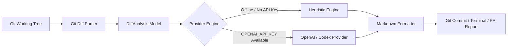

# ⚡ Git Clarity

> **AI-native Git diff analyzer, conventional commit synthesizer, and automated PR review assistant for modern engineering teams.**

[](https://github.com/username/git-clarity/actions)
[](https://opensource.org/licenses/MIT)
[](https://www.python.org/downloads/)
[](CONTRIBUTING.md)

---

## 💡 Overview

Writing clean commit messages, conducting rapid pre-flight code reviews, and assembling accurate release changelogs are time-consuming parts of daily software development. 

**Git Clarity** is a lightweight, zero-dependency CLI tool and agent framework that inspects your Git workspace, parses diff hunks, extracts semantic intentions, and provides:
1. **Automated Conventional Commits** conforming to [Conventional Commits v1.0.0](https://www.conventionalcommits.org/).
2. **Instant Pre-commit Security & Hygiene Audits** (detects leaked credentials, untested logic paths, and critical edge cases).
3. **Structured Markdown PR & Release Changelogs** categorized automatically by change impact.
4. **Hybrid Engine**: Works 100% offline via an intelligent heuristic rule engine, and seamlessly elevates to OpenAI / Codex / custom LLMs when an API key is provided.

---

## ✨ Key Features

- **🎯 Context-Aware Diff Parsing**: Parses unified diffs, tracks modified symbols (functions, classes, methods), and calculates file impact metrics.
- **📝 Semantic Commit Generation**: Suggests clean `type(scope): subject` messages with bulleted summaries directly from staged changes.
- **🛡️ Built-in Code Reviewer**: Inspects added code for hardcoded secrets, dangerous keywords, and missing test coverage before you commit or push.
- **📦 Automated Changelog Generator**: Turns commit history between tags or branches into formatted GitHub Markdown release notes.
- **⚡ Zero Mandatory Dependencies**: Works out-of-the-box on standard Python 3.9+ without needing external packages.

---

## 🚀 Quick Start

### Installation

Install via pip:

```bash
git clone https://github.com/<your-username>/git-clarity.git
cd git-clarity
pip install -e .
```

To enable enhanced LLM reasoning with OpenAI:

```bash
pip install -e ".[ai]"
export OPENAI_API_KEY="your-api-key"
```

---

## 💻 CLI Usage

### 1. Generate & Apply Conventional Commits
Stage your files and run `git-clarity commit`:

```bash
git add src/
git-clarity commit
```

**Interactive Example:**
```text
⚡ Git Clarity v0.2.1 — AI-Native Git Workflow & Review Assistant
------------------------------------------------------------
Analyzing staged changes across 3 files...

Generated Commit Message:
feat(auth): implement token refresh rotation mechanism

- add `src/auth/jwt.py` (RefreshTokenHandler, rotate_keys): +42/-4
- update `src/api/routes.py`: +12/-2
- add `tests/test_jwt.py`: +35/-0

Commit with this message? [Y/n/e(dit)]: y
✔ Successfully committed!
```

Flags:
- `-y`, `--yes`: Automatically accept and commit without prompting.
- `-d`, `--dry-run`: Preview the generated message without committing.
- `--offline`: Force the local heuristic rule engine even if an API key is set.

---

### 2. Pre-Commit Code Review
Audit active modifications before pushing:

```bash
# Review unstaged changes
git-clarity review

# Review staged changes in Markdown format
git-clarity review --staged --markdown
```

**Example Output:**
```markdown
### 🔍 Git Clarity Code Review Report

| Level | File | Category | Findings |
| :--- | :--- | :--- | :--- |
| 🚨 `CRITICAL` | `config/settings.py` | Security | Potential hardcoded secret or token detected in addition. |
| ⚠️ `WARNING` | `General` | Testing | Source code modified without corresponding unit test updates. |
| ✅ `PASS` | `core/engine.py` | Quality | Diff looks clean and well-scoped across 2 files. |

> _Generated automatically by [Git Clarity](https://github.com)_
```

---

### 3. Generate Release Changelogs
Aggregate recent commits into categorized markdown:

```bash
git-clarity changelog -n 20
```

---

## 🏛️ Architecture



---

## 🧪 Testing

Run the test suite locally with `unittest`:

```bash
python3 -m unittest discover -s tests
```

---

## 🤝 Contributing

Contributions are warmly welcome! Please see [CONTRIBUTING.md](CONTRIBUTING.md) for details on setting up your environment and submitting pull requests.

## 📄 License

This project is open-source under the [MIT License](LICENSE).
